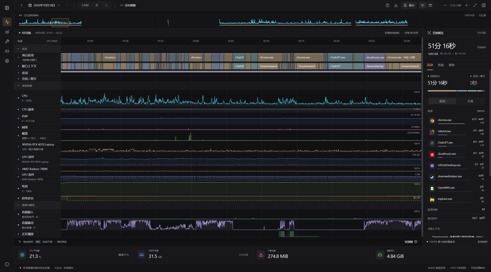
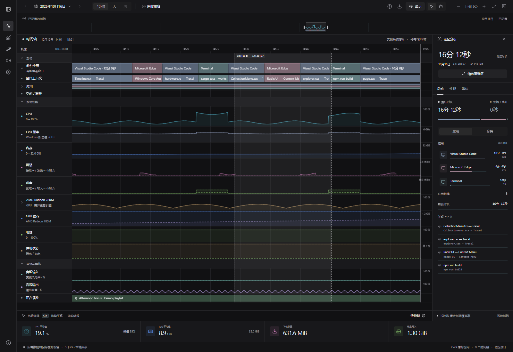

# Tracel

**看见时间去了哪里，也看见电脑发生了什么。**

Tracel 是一款 Windows 桌面应用，把应用活动、窗口、系统性能、音频与电池状态放在同一条可自由缩放的时间轴上。回看今天用了哪些应用、电脑什么时候忙起来，或选中一段时间，查看这段时间的活动与性能分析。

名字取自 **Trace + Log**：追踪，并留下可以回看的记录。

[下载 Windows 版](https://github.com/Dreamtowards/Tracel/releases) · [使用方式](#开始使用) · [开发指南](docs/development.md)



*截图来自实际桌面界面，使用虚构示例数据，不包含个人活动记录。*

## 为什么做 Tracel

重度使用电脑时，一天很容易在窗口切换之间过去。我喜欢追踪时间：看到时间花在了哪里，会更有掌控感，也会对完成的事情更有成就感。

Tracel 想把这种回看做得更直观。不仅知道当时在用什么应用，也能沿着同一条时间轴看到 CPU、网络、音频和供电状态。工作、游戏、视频播放留下的不同轨迹，本身就值得看看；遇到疑问时，也能回到那段时间寻找线索。

## 可以看到什么

| 轨道 | 记录内容 |
| --- | --- |
| 应用与窗口 | 前台应用、窗口标题、桌面应用存在状态、空闲时段 |
| CPU 与内存 | CPU 利用率与频率、物理内存占用 |
| GPU 与显存 | GPU 利用率、各引擎利用率、专用与共享显存占用 |
| 网络与磁盘 | 物理网络收发、磁盘读写速率 |
| 音频与媒体 | 麦克风和输出电平、系统选中的媒体会话标题与播放/暂停状态 |
| 电池与供电 | 电量百分比、插电与充电状态 |

每类采集都可以独立开启或关闭。右键时间轴左侧表头即可调整采集开关；总开关关闭后停止采集，已有历史仍可回看。指标是否可用取决于硬件、驱动和应用支持，缺失读数不会当成零。

## 一条时间轴，多种看法

- **缩放与平移**：从一天的整体节奏，放大到秒级细节；展开应用或 GPU 引擎，查看各自的轨道。
- **拖选即分析**：选中一段时间，右侧显示应用与分类排行、性能统计和媒体记录；没有选区时，分析当前可见范围。
- **历史与实时跟随**：按日期回看本地记录，或跟随最新数据；支持导出选定范围的 JSON。
- **内置应用分类**：提供默认分类规则，也可以编辑分类 JSON，让历史视图按新规则重新分类。
- **音频排查**：独立的音频页面显示各输出设备上的应用会话电平、音量和近期信号，帮助寻找声音来源。



*选区分析示例，同样使用虚构数据。*

## 开始使用

1. 在 [GitHub Releases](https://github.com/Dreamtowards/Tracel/releases) 下载 Windows x64 的 `.exe`，可用同版本 `.sha256` 文件校验下载内容。
2. 直接运行 EXE。需要 Windows WebView2 运行时；首次启动默认关闭采集。
3. 开启采集总开关，并选择希望记录的项目。使用一段时间后，就可以回看自己的时间轴。

当前是持续开发中的预览版本。发布包暂放在私有仓库中，下载需要对应的 GitHub 仓库访问权限。

## 数据与当前边界

活动记录和采集设置保存在本机。麦克风轨道只读取电平，不录音；应用活动采集不记录按键或文件内容。窗口标题可能包含文档名称，请按自己的需要选择是否开启。

目前支持 Windows。应用存在状态覆盖带桌面窗口的应用，包括最小化窗口，并非所有后台进程或服务；浏览器 URL 提取尚未实现。原生历史当前按单日查询，跨多日浏览仍待完善。关闭 App 会停止采集，尚不支持独立后台服务，也没有自动清理历史的策略。更多说明见[采集器文档](docs/collectors.md)。

## 在线演示与开发

网站首页介绍 Tracel，`/timeline` 在线演示复用桌面 App 的界面，并单独注入虚构数据。演示不会监测访问者的电脑，不支持的系统操作会禁用。

本地启动网站：

```sh
npm ci
npm run dev
```

启动后打开[产品首页](http://127.0.0.1:3000/)或[时间轴演示](http://127.0.0.1:3000/timeline)。原生 Windows 开发使用 `npm run dev:desktop`，需要 Rust MSVC、Windows SDK 等构建工具，详见[开发与部署指南](docs/development.md)。

- [桌面端与发布说明](apps/desktop/README.md)
- [架构](docs/architecture.md) · [数据模型](docs/data-model.md) · [共享时间轴组件](packages/timeline/README.md)

仓库还保留了早期的 **Radar** 地球仪与地图演示，位于网站 `/radar` 路径，使用模拟访客数据。它是独立的网页体验；Tracel 桌面端不包含 Radar。相关说明见 [Radar 文档](apps/web/README.md)。
